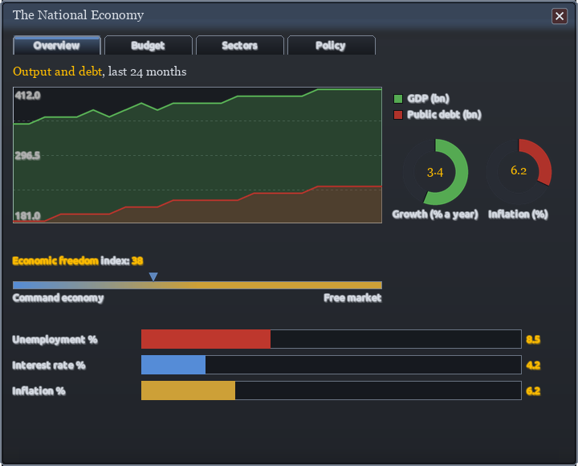
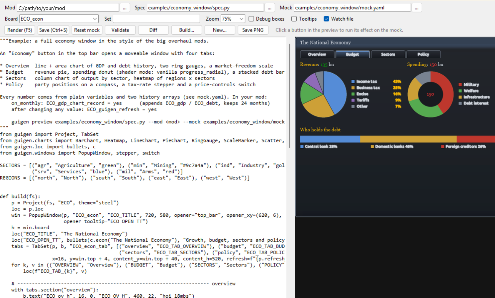
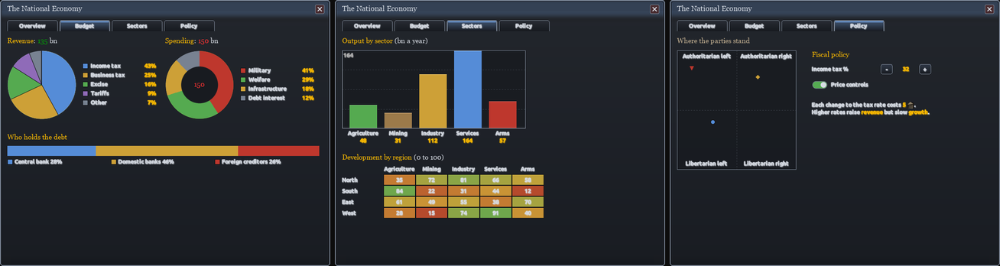
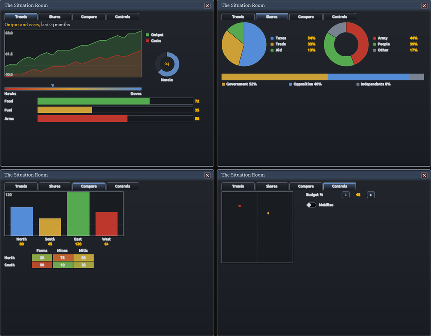

# guigen: scripted GUIs for Hearts of Iron IV

guigen turns a short YAML or Python spec into a working HOI4 scripted GUI:
- decision-tab boards and interactive popup windows;
- charts: bar, pie, donut, line, area, stacked bars, gauges, heatmaps, scatter plots;
- tabs, steppers and switches;
- all the files behind them: `.gui`, `.gfx`, `common/scripted_guis`, the scripted effects that feed
  the charts, scripted localisation, loc, and the sprite sheets themselves (drawn with Pillow).

Three more things come with it:
- **Validation** against your mod and the base game.
- **A safe build:** `diff` stages everything and shows what would change before a single file in
  the mod is touched.
- **A preview:** `preview` and the desktop app draw your windows with the game's own fonts and a
  mock game state. You can click through tabs and buttons without launching the game.



## The exe (no Python needed)

Two standalone Windows programs. They are x64, so they run on any Windows 10/11 PC; ARM PCs run them
through Windows' built-in emulation.

| exe | what it is | how to use it |
|---|---|---|
| `GUIGen.exe` | the desktop app | Double-click it, or drop a `.yaml` / `.py` spec onto it to open that spec. A `<spec>_mock.yaml` next to the spec is picked up too. |
| `guigen-cli.exe` | the command line | Same commands as `guigen` below, e.g. `guigen-cli new XYZ`, `guigen-cli preview spec.yaml --mod <mod>`. |

No install is needed: copy them anywhere.
- The first start takes a few seconds while the exe unpacks itself.
- The preview works before you pick a mod. Base-game sprites, fonts and loc are found
  automatically.
- Validate, diff and build need the mod folder.

Python specs (`.py`) work too. They can import `guigen` and the standard modules guigen itself uses
(`os`, `re`, `math` and so on).

To build the exes yourself, use an x64 Python with `pip install pyinstaller pillow numpy pyyaml`:

```bash
python packaging/build_exe.py
```

The exes land in `dist/`.

## Install as a Python package

You need Python 3.10 or newer.

```bash
python -m pip install -e .
```

This installs two commands: `guigen` and `guigen-app`. On Windows they land in Python's `Scripts`
folder. If that folder isn't on your PATH, use `python -m guigen ...` instead.

`guigen doctor` checks the packages, finds your HOI4 install (or reads `HOI4_PATH`) and its fonts.
`guigen themes` lists the colour themes.

## Start in 30 seconds

```bash
guigen new XYZ --folder myboards
```
```bash
guigen preview myboards/XYZ_window.yaml --mod "C:/path/to/your/mod" --mock myboards/XYZ_window_mock.yaml
```
```bash
guigen app
```

`new` writes a starter spec and a mock state:

| template | what you get |
|---|---|
| `--template window` (default) | a moveable window opened from the top bar, with four tabs that use every chart type |
| `--template board` | a decision-tab board |

`app` opens the desktop app.

## The desktop app



- **Pick files:** pick the mod folder, a spec (YAML or Python) and a mock state. They are
  remembered between runs.
- **Edit:** edit the spec on the left. **Ctrl+S** saves and re-renders. With **Watch file** on, it
  also re-renders when you save from your own editor.
- **Click through the preview:** clicking a **button** runs its scripted effect on the mock state.
  You can switch tabs, close the window, step a value up or flip a switch. Clicking anything else
  shows its name and tooltip.
  - **Reset mock** goes back to the mock file.
  - **Set** overrides values, e.g. `XYZ_tab=2 flag:XYZ_window_open XYZ_hist=[1,2,3]`.
- **Inspect:** **Debug boxes** outlines every element. **Tooltips** renders every tooltip of the
  board.
- **Check and write:** **Validate** and **Diff** run the same checks as the command line.
  **Build...** lists what would change in the mod and asks before writing.

## Commands

```bash
guigen new       PREFIX [--template window|board] [--folder DIR]
guigen preview   SPEC [--mod MOD] [--mock MOCK] [--set VAR=VALUE ...] [--board NAME] [--debug] [--out DIR]
guigen validate  SPEC [--mod MOD]
guigen diff      SPEC [--mod MOD]
guigen build     SPEC [--mod MOD] [--yes]
guigen app | doctor | themes
```

`--mod` defaults to `$GUIGEN_MOD` or the last mod picked in the app.

| command | what it does |
|---|---|
| `diff` | Builds in a temp folder and compares with the mod: text byte for byte (with a unified diff), PNGs pixel by pixel, loc entry by entry. It exits 1 on any difference. |
| `build` | Refuses to overwrite changed files without `--yes`. |
| `preview` | Writes `<board>.png`, `<board>_tooltips.png` and `all_boards.png`. |

## Charts

Every chart takes its data from plain variables, or from history arrays for line charts. It also
writes a scripted effect that turns the data into sprite frames. Call `PREFIX_guigen_refresh = yes`
after your data changes; it updates every chart and frame variable. Opening a popup window calls
it for you.

| chart | YAML `type` | Python | data |
|---|---|---|---|
| columns | `bar` | `BarChart` | one variable per bar; `max` fixed, a variable, or the largest bar |
| horizontal bars | `hbar` | `BarChart(horizontal=True)` | same |
| stacked bar | `stacked` | `StackedBar` | parts add up to their sum, or to `total` |
| pie / donut | `pie` / `donut` | `PieChart(inner=0.55)` | slices; percentages are written to `<name>_p_<k>` |
| line / area | `line` / `area` | `LineChart` | arrays; `<name>_record = yes` appends `source` and keeps `points` entries |
| ring gauge | `ring` | `RingGauge` | one variable between `lo` and `hi` |
| marker on a scale | `scale` | `ScaleMarker` | one variable, moved with an `x` position property |
| scatter / compass | `scatter` | `Scatter` | x and y variables per point, positioned with `x` / `y` properties |
| heatmap | `heatmap` | `Heatmap` | one variable per cell, e.g. `XYZ_grid_{row}_{col}` |
| legend | `legend:` element | `legend()` | label and colour pairs |

Charts render in one of two modes:

**Sprite mode** (the default) works in any mod with no shaders. Each chart is a pre-rendered frame
sheet:
- **Pies and stacked bars** are layers cut to cumulative shares. Slice *k* is drawn to the share of
  slices 1..*k*, the biggest layer first, so each slice shows exactly its own wedge.
- **Line charts** use one cell per segment, with `levels × levels` frames, so the frame number
  encodes where the segment starts and ends. The number of levels is picked automatically to keep
  sheets within 8192 px.

**Shader mode** draws charts with `progressbartype` sprites:
- `PieChart(mode="shader")`: pies use the base game's own `progress_radial.lua`, which fills
  clockwise from 12 o'clock.
- `mode="auto"` (the default for horizontal and stacked bars): wide bars switch to the base game's
  `progress.lua` when a sprite sheet would be too wide.
- `LineChart(mode="shader")`: smooth line charts use guigen's own `gfx/FX/guigen_line.shader`,
  which is written for you. This shader is **experimental**: it follows the structure of the
  base-game progress shaders but has not been tested in game.

The preview emulates both modes.

| | |
|---|---|
|  |  |

## Interactive windows

```yaml
boards:
  - name: XYZ_window
    window: {title: XYZ_TITLE, w: 720, h: 560, opener: top_bar, opener_xy: [620, 6], opener_tooltip: XYZ_OPEN_TT}
    elements:
      - tabs:
          var: XYZ_tab
          height: 470
          tabs:
            - {key: trends, label: XYZ_TAB_TRENDS, elements: [...]}
```

`PopupWindow` (`window:` in YAML) writes two scripted GUIs:

- **The window:**
  - context `player_context`, so it shows over the map;
  - `visible = { has_country_flag = <name>_open }`;
  - moveable and centred on screen;
  - a stretchable 9-slice panel (`corneredTileSpriteType`), a title and a close button.
- **The opener:** a button in a base-game panel that toggles the flag and refreshes the charts.
  - `opener` picks the panel: `top_bar`, `politics_tab`, `decision_tab`, `trade_tab` and so on, with
    `opener_xy` for the button's position;
  - `decision_category` makes the opener a decision-tab board;
  - `null` makes no opener.

These controls work anywhere:

| control | what it does |
|---|---|
| `tabs` / `TabSet` | One variable picks the open tab; each tab's content is a child window shown by one trigger. |
| `toggle` / `Toggle` | A collapsible section. |
| `stepper` | `[-] value [+]`, clamped between `lo` and `hi`, with an optional `cost` effect per click. |
| `switch` | An on/off switch for a 0/1 variable. |

## Specs

### YAML

[`guigen/yamlspec.py`](guigen/yamlspec.py) documents the full schema. Its main parts:

| part | contents |
|---|---|
| `project` | `prefix`, which replaces `$P$` everywhere; `theme`, a name or `{base, accent, bars}`; file overrides; `loc_mode` |
| `sprites` | `bar`, `pips`, `dial`, `gauge`, `card`, `solid` |
| `frames` | `{var, source}` (linear), `{thresholds}` or `{flags}` |
| `boards` | each with `context`, `parent_token`, `visible`, `dirty`, or `window:` for a popup |
| elements | `text`, `icon`, `bar`, `button`, `header`, `row`, `space`, `repeat`, `tabs`, `toggle`, `chart`, `legend`, `stepper`, `switch` |
| `loc`, `scripted_loc` | localisation entries and `defined_text` cases |

Elements stack top to bottom. Set `y` to move the cursor, `dy` to nudge one element, and use `row`
to share a line. Examples:

| example | what it is |
|---|---|
| [`examples/iron_ore_board/board.yaml`](examples/iron_ore_board/board.yaml) | a decision-tab board with tabs, a dial and gauges |
| [`examples/situation_room/SIT_window.yaml`](examples/situation_room/SIT_window.yaml) | the `window` template output |

### Python

Use Python when a board needs loops over data or computed text. A spec is a module with
`build(fs) -> Project`. [`examples/economy_window/spec.py`](examples/economy_window/spec.py) is a
complete economy window:

```python
from guigen import Project, TabSet
from guigen.charts import LineChart, PieChart
from guigen.windows import PopupWindow

def build(fs):
    p = Project(fs, "XYZ", theme="steel")
    win = PopupWindow(p, "XYZ_econ", "XYZ_TITLE", 720, 560, opener="top_bar", opener_xy=(620, 6))
    b = win.board
    tabs = TabSet(p, b, "XYZ_tab", [("trends", "XYZ_TAB_T"), ("budget", "XYZ_TAB_B")], x=16, y=win.top + 4,
                  content_y=win.top + 40, content_h=480)
    with tabs.section("trends"):
        LineChart(p, b, "XYZ_gdp", 16, 10, 460, 170, points=24, area=True,
                  series=[{"array": "XYZ_gdp_hist", "source": "XYZ_gdp", "label": "GDP", "colour": "good"}])
    with tabs.section("budget"):
        PieChart(p, b, "XYZ_rev", 16, 10, 150, [("XYZ_tax", "Taxes", "blue"), ("XYZ_trade", "Trade", "gold")])
    p.loc("XYZ_TITLE", "The Economy")
    p.loc("XYZ_TAB_T", "Trends")
    p.loc("XYZ_TAB_B", "Budget")
    return p
```

These are available in Python:

| kind | names |
|---|---|
| board elements | `text`, `icon`, `button`, `gridbox` |
| wiring | `prop`, `visible`, `enabled`, `click` (also with `modifier="right"`), `dynamic_list` |
| widgets | `header`, `stat_row`, `frame_bar`, `state_map`, `card`, `list_rows` |
| sprites | `Bar`, `Pips`, `Dial`, `Gauge`, `Card`, `FillBar`, `Wedge`, `LineSegments`, `ChartBackground`, `Marker`, `Gradient`, `Panel`, `ProgressBarSprite`, `StateMap` (one sprite per state cut from `map/provinces.bmp`) |
| frame rules | `Linear`, `Thresholds`, `Flags`, `Raw` |

### Contexts

`context=` takes any HOI4 context type: `player_context`, `selected_country_context`,
`selected_state_context`, `diplomacy_target_context`, `decision_category`, `diplomatic_action`,
`national_focus_context`, `country_mapicon` and `state_mapicon`.

`parent_token=` takes any token in the game's `_documentation.md`, such as `top_bar`,
`selected_state_view`, `politics_tab`, `trade_tab`, the ledgers and the tech folders.
`parent_window=` writes `parent_window_name`.

## Preview and mock state

```yaml
vars:   {XYZ_gdp: 412, political_power: 120, XYZ_tab: 1}
arrays: {XYZ_gdp_hist: [352, 355, 361, 358]}       # ARR^num and ARR^i work in triggers and text
flags:  [XYZ_window_open]
state_flags: {716: [XYZ_surveyed]}
focuses: []
scripted_loc: {GetXYZMood: XYZ_MOOD_1}              # force a defined_text case
default_var: 0
show_all: false
```

The renderer works through the spec the way the game would:
- it evaluates `_visible` and `_click_enabled` triggers;
- it computes every chart and frame from the mock;
- it resolves loc, scripted loc, `[?var|fmt]`, `£icons` and `§colours`;
- it draws text with the game's bitmap fonts, wrapped and clipped like the game does.

It reports any text that doesn't fit its box. The layout engine is guigen's own, so treat a
pixel-tight fit as a hint.

## Validation

`validate` (also run by `build`) reports these as errors:
- undefined sprites or missing textures;
- loc keys that no localisation defines;
- undefined scripted loc;
- wiring for elements that don't exist;
- frame variables that go past their sprite's frames;
- clicks that call undefined scripted effects;
- wrong line endings or unbalanced braces.

It reports these as warnings:
- frame variables nothing sets;
- sheets wider than 8192 px;
- overlapping text (sections that never show together are skipped);
- duplicate or reused names;
- boards that no decision category references;
- `§` colour code problems;
- text that doesn't fit its box, measured with the game font.

## Text rules

Each loc entry is checked when it is added. A `LocError` stops the build if it contains an
em-dash, `--`, a real line break, or an unescaped `"`. Write line breaks as a literal `\n`: use
`NL`, `BULLET` or `bullets()` from `guigen.loc`.

Colour helpers in `guigen.loc.c`:

| code | use | helper |
|---|---|---|
| `§Y` | economy | `c.econ` |
| `§L` | politics | `c.pol` |
| `§O` | security | `c.sec` |
| `§C` | places | `c.place` |
| `§G` / `§R` | good / bad values | `c.good`, `c.bad`, `c.signed(v)` |

## Line endings

Files are written as bytes:

| `--eol` | effect |
|---|---|
| `auto` (default) | match the file already in the mod, then the copy in git `HEAD`, then CRLF |
| `crlf` / `lf` | always use that ending |

## Tests

```bash
python -m unittest discover -s tests
```

The tests build a throwaway mod and cover:
- frame and chart maths;
- the loc rules and yml merge;
- line-ending choice;
- the validator, on clean and broken projects;
- `diff`;
- tabs, popup windows, the click interpreter and both templates.

`tests/fixtures/port_reference` holds a three-board regression port that must rebuild a reference
mod byte for byte. Set `GUIGEN_REFERENCE_MOD` to that mod's folder to run it.

## Repo layout

```
guigen/      the package (cli.py, app.py, project, board, elements, charts, chartsprites, windows, tabs,
             preview, mock, validate, yamlspec, templates, shaders, sprites, statemap, theme, loc, frames)
examples/    economy_window (Python), situation_room (YAML, from `guigen new`), iron_ore_board (YAML)
tests/       unit tests and the regression fixture
docs/        screenshots
```
