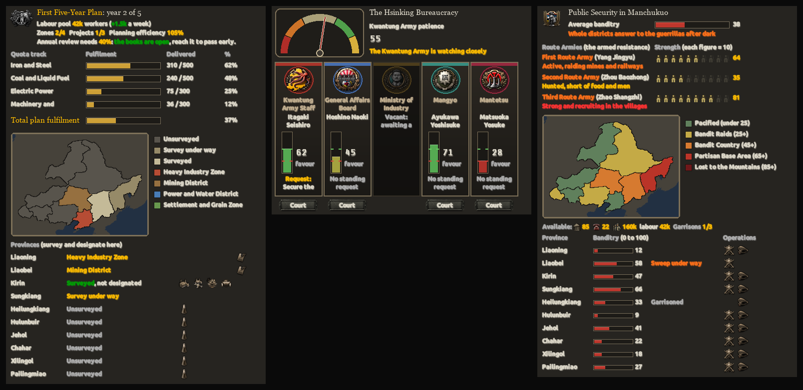
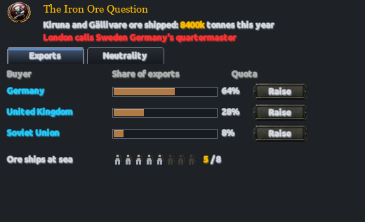
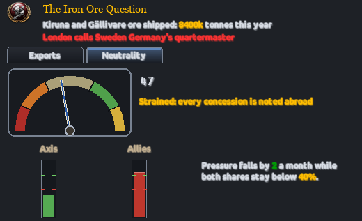
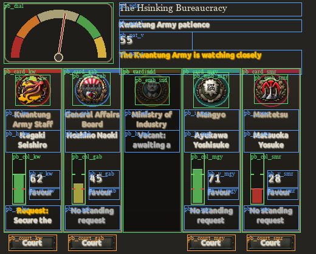

# guigen: scripted GUI generator for Hearts of Iron IV

guigen turns a short Python or YAML spec into everything a HOI4 scripted GUI needs:

* `interface/*.gui` windows (text boxes, icons, buttons, grid boxes, nested sections)
* `interface/*.gfx` sprite types, and the sprite sheets themselves (PNG, drawn with Pillow)
* `common/scripted_guis/*.txt` with `properties` (frame / x / y / image), `triggers`, `effects`, `dynamic_lists`
* the scripted effect that turns game variables into sprite frames (clamp, divide, round)
* `common/scripted_localisation/*.txt` (`defined_text`) and the loc `.yml`

It also validates the result against the mod and vanilla, diffs a build against the live mod before
writing anything, and renders a mock of each board to PNG with the game's own fonts, so a layout
can be checked without launching the game.

It grew out of the one-off Manchukuo (MAN) generator in [`seed/`](seed). The three MAN boards are
ported to [`specs/MAN/spec.py`](specs/MAN/spec.py), and that port rebuilds the live MAN files
**byte for byte** (see [The MAN port](#the-man-port)).



## Setup

Python 3.10+ with Pillow, numpy (state maps only) and PyYAML (YAML specs and mock files):

```bash
python -m pip install -r requirements.txt
```

The HOI4 install is found automatically in the usual Steam folders. Otherwise pass `--vanilla` or
set `HOI4_PATH`. Without it, validation skips vanilla sprites and loc, and the preview falls back
to a TrueType font.

## Commands

```bash
python -m guigen diff     specs/MAN/spec.py --mod "C:/path/to/mod"
python -m guigen validate specs/MAN/spec.py --mod "C:/path/to/mod"
python -m guigen preview  specs/MAN/spec.py --mod "C:/path/to/mod" --mock specs/MAN/mock.yaml
python -m guigen build    specs/MAN/spec.py --mod "C:/path/to/mod"
```

| command    | what it does |
|------------|--------------|
| `diff`     | Builds into a temp folder and compares every output with the mod. It compares text byte for byte (with a unified diff), PNGs pixel by pixel, merged loc entry by entry, and embedded blocks (see `Project.embed`) inside files another build owns. It exits 1 on any difference. Nothing in the mod is touched. |
| `validate` | Runs the static checks listed below on a staged build. |
| `preview`  | Writes `<board>.png`, `<board>_tooltips.png` and `all_boards.png` (default: `preview/` next to the spec). `--debug` outlines and names every element. `--board NAME` limits it to some boards. |
| `build`    | Writes into the mod. It refuses when an existing file would change, so run `diff` first, then `build --yes`. |

Options for all commands: `--eol auto|crlf|lf` (default `auto`, see [Line endings](#line-endings)).

## A board in YAML

A new country board is one short file. [`specs/example_SWE/board.yaml`](specs/example_SWE/board.yaml)
is a complete example with a theme, tabs, repeated rows, a dial, gauges, pips and scripted loc:

```yaml
project:
  prefix: SWE                                  # $P$ anywhere becomes SWE
  theme: {base: steel, bars: {ore: [176, 122, 70]}}
sprites:
  - {type: bar, name: bar_ore, w: 150, h: 14, colour: ore}    # -> GFX_SWE_bar_ore, gfx/interface/SWE/SWE_bar_ore.png
  - {type: dial, name: neutrality}
frames:
  - {var: SWE_f_buy_ger, source: SWE_buy_ger}                 # 0..100 -> frames 1..11
  - {var: SWE_f_neutral, source: SWE_neutrality, frames: 21}
boards:
  - name: SWE_ore_board
    context: decision_category
    elements:
      - header: {emblem: GFX_goal_generic_trade, help: SWE_ORE_HELP_TT, title: SWE_ORE_TITLE, subs: [SWE_ORE_SUB1]}
      - repeat:
          for: {ger: Germany, eng: United Kingdom}
          as: k
          elements:
            - row:
                height: 26
                items:
                  - text: {name: SWE_n_$k$, text: SWE_N_$k$, w: 140}
                  - bar:  {name: SWE_bar_$k$, x: 160, dy: 3, sprite: GFX_SWE_bar_ore, frame_var: SWE_f_buy_$k$}
                  - button: {name: SWE_raise_$k$, x: 360, sprite: GFX_button_94x31, text: SWE_RAISE,
                             enabled: "has_political_power > 9.99", click: "add_political_power = -10"}
loc:
  SWE_ORE_TITLE: "§YThe Iron Ore Question§!"
```

Elements stack top to bottom on a running `y`. The board height is the bottom of the last element
plus `pad`, unless you set `height`. The full schema is in the docstring of
[`guigen/yamlspec.py`](guigen/yamlspec.py). It covers `text`, `icon`, `bar`, `button`, `header`,
`row`, `space`, `repeat`, `tabs` and `toggle`, plus `x`, `y`, `dy` and `h` overrides.

| Exports tab | Neutrality tab |
|---|---|
|  |  |

## A board in Python

Use Python when a board needs loops over data, computed tooltips or a state map. A spec is a module
with `build(fs) -> Project`:

```python
from guigen import Project, Bar, Linear, widgets as W
from guigen.loc import c, bullets

def build(fs):
    p = Project(fs, "XYZ", theme="crimson")            # file names default to interface/XYZ_guigen.gui etc.
    p.sprite(Bar("GFX_XYZ_bar", p.png("bar"), 150, 14, "red"))
    p.frame(Linear("XYZ_f_unrest", "XYZ_unrest"))

    b = p.board("XYZ_board", context="decision_category")
    y = W.header(b, "XYZ_hd", "GFX_goal_generic_trade", "XYZ_HELP_TT", "XYZ_TITLE")
    b.text("XYZ_unrest_l", 10, y, "XYZ_UNREST_L", 140)
    b.icon("XYZ_unrest", 160, y + 3, "GFX_XYZ_bar", frame_var="XYZ_f_unrest", tooltip="XYZ_UNREST_TT")
    b.button("XYZ_calm", 320, y, "GFX_button_94x31", "XYZ_CALM_TT", text="XYZ_CALM",
             enabled="has_political_power > 24.99",
             click="add_political_power = -25 add_to_variable = { XYZ_unrest = -10 } XYZ_guigen_refresh_frames = yes")
    b.auto_height()

    p.loc("XYZ_TITLE", "Unrest")
    p.loc("XYZ_HELP_TT", c.sec("Unrest") + "\\nRises with every strike, falls when you calm the streets")
    p.loc("XYZ_UNREST_L", "Unrest")
    p.loc("XYZ_UNREST_TT", "§OUnrest§!: §Y[?XYZ_unrest|0]§!")
    p.loc("XYZ_CALM", "Calm")
    p.loc("XYZ_CALM_TT", bullets(c.econ("Calm the streets"), "Cost: §Y25§! £pol_power", f"Unrest: {c.signed(-10, good_if_positive=False)}"))
    return p
```

Board methods: `text`, `icon`, `button`, `gridbox`. Wiring: `prop`, `visible`, `enabled`, `click`
(with `modifier="right"`, `"shift"` and so on), `trigger`, `effect`, `dynamic_list`. Pass `frame_var=`,
`visible=`, `enabled=` or `click=` to an element helper to wire it in place, or call the wiring
methods later to control the order of the scripted GUI blocks.

### Widgets ([`guigen/widgets.py`](guigen/widgets.py))

| widget | what it builds |
|---|---|
| `header` | an emblem button carrying the help tooltip, a title and sub lines |
| `stat_row` | label, frame bar, value and percent on one row |
| `frame_bar` | any frame-driven icon: bar, pips, dial, gauge |
| `state_map` | a `StateMap` layer: the backdrop, one icon per state with a frame variable, tooltip and visible trigger, and a legend |
| `card` | an institution card: background, an emblem fitted into the ring (`fit_into`), a gauge, a vacancy overlay, texts and a button |
| `list_rows` | static rows over a list |

### Sprites ([`guigen/sprites.py`](guigen/sprites.py))

`Bar`, `Pips` (soldier or dot figures), `Dial` (a semicircle with bands and a needle), `Gauge`
(a vertical column with threshold ticks), `Card`, `Solid`, `Swatches` (legend keys), `Tabs` and
`Static` (your own draw function). `StateMap` ([`guigen/statemap.py`](guigen/statemap.py)) cuts one
sprite per state out of `map/provinces.bmp`, with one frame per colour of each layer.

Each sprite is a horizontal strip of `frames` cells, and `noOfFrames` is written when there is more than one.

### Frames ([`guigen/frames.py`](guigen/frames.py))

| rule | maps |
|---|---|
| `Linear(var, source, frames=11, lo=0, hi=100)` | `round((source - lo) / step) + 1`, clamped to 1..frames |
| `Thresholds(var, source, [25, 45, 65])` | frame 1, then 2, 3, 4 above each threshold |
| `Flags(var, scope, [flag_a, flag_b])` | frame 1, then 2, 3 when the scope has the flag (later flags win) |
| `Raw(text)` | hand-written lines, kept in order |

All rules go into one scripted effect, by default `<P>_guigen_refresh_frames` in
`common/scripted_effects/<P>_guigen_frames.txt`. Call it from your weekly pulse and from clicks.
The validator checks that each rule reaches exactly as many frames as the sprite it drives.

### Contexts

`context=` takes any HOI4 context type: `player_context`, `selected_country_context`,
`selected_state_context`, `diplomacy_target_context`, `decision_category`, `diplomatic_action`,
`national_focus_context`, `country_mapicon` and `state_mapicon`.

`parent_token=` attaches a board to a vanilla window: `top_bar`, `selected_state_view`,
`politics_tab`, `decision_tab`, the ledgers and the tech folders. All tokens from the game's
`_documentation.md` are accepted.

Also available: `parent_gui=`, `visible=`, `dirty=`, `map_mode=` and `mapicon_targets=`.
`parent_window=` writes `parent_window_name`. The game's documentation spells this key
`parent_window_window` and no vanilla file uses it, so test it in game before relying on it.

### Tabs and toggles ([`guigen/tabs.py`](guigen/tabs.py))

```python
tabs = TabSet(p, b, "XYZ_tab", [("eco", "XYZ_TAB_ECO"), ("pol", "XYZ_TAB_POL")], x=10, y=90, content_y=120, content_h=300)
with tabs.section("eco"):
    b.text("XYZ_eco_title", 10, 0, "XYZ_ECO_TITLE", 300)      # coordinates relative to the section
```

* Every section is a child `containerWindowType` with one `_visible` trigger on the tab variable.
* Every tab has an idle button (click sets the variable) and a selected button at the same place.
* The variable lives in the board's scope and starts at 0, so the first tab is open by default.

`Toggle` is a single collapsible section. A collapsed section leaves its space empty, because the
board height is fixed.

### Themes ([`guigen/theme.py`](guigen/theme.py))

| theme | look |
|---|---|
| `manchukuo` | the original MAN palette: dark parchment and brass. Changing it breaks the byte-identical port. |
| `steel` | cool grey-blue |
| `crimson` | deep red with gold trim |
| `jade` | muted green with bronze |

A theme sets the panel tints, outlines, needle, pips, map sea and land, the named bar colours and
the preview background. Derive your own with `Theme.get("steel").derive(accent=(160, 30, 30), bars={"main": (190, 50, 40)})`.

## Preview and mock state

`preview` draws each board as the game would:
* real sprites (generated, mod or vanilla, including DDS) at their real positions and frames;
* text in the game's own bitmap fonts from `gfx/fonts/*.fnt`, with the game's `§` colour table and
  `£` text icons;
* word wrap, clipping to `maxHeight`, and the box's `format`.

A mock file sets the game state. The renderer evaluates the generated triggers against it, so hidden
elements disappear, disabled buttons are dimmed, and frames come from the frame rules:

```yaml
vars: {MAN_pct_steel: 62, political_power: 85, MAN_h_ind: 0}
default_var: 0
flags: [MAN_review_running]
state_flags: {716: [MAN_surveyed, MAN_zone_hi]}
focuses: []
not_owned: [1043]
scripted_loc: {GetMANPlanTitle: MAN_PLT_1}      # force a defined_text case
show_all: false
```

The preview lists every text box whose text does not fit, and `<board>_tooltips.png` renders every
tooltip, to check wording and colours. The fonts are the real ones, but the layout engine is mine,
so treat a pixel-tight fit as a hint.



## Validation

`validate` (also run after `build`) reports these as **errors**:
* undefined sprite types or missing textures;
* loc keys used by texts, tooltips or button texts that no loc defines (generated, mod or vanilla);
* `[Scope.GetX]` scripted loc that no `defined_text` defines and that isn't an engine getter;
* properties, triggers or effects for elements the window doesn't have;
* frame variables that reach past their sprite's frames;
* clicks calling undefined scripted effects;
* wrong line endings or unbalanced braces in written files.

It reports these as **warnings**:
* frame variables nothing sets;
* sprites with frames the variable never reaches;
* unbalanced or unknown `§` codes;
* elements outside the window;
* overlapping text boxes (sections that never show together are skipped);
* duplicate names;
* window names reused by another `.gui` file;
* `decision_category` boards that no category references with `scripted_gui = NAME`;
* conflicting duplicate loc;
* **text that does not fit its box**, measured with the game font.

## Text rules

Every loc entry is checked when it is added, and a `LocError` stops the build when:
* it contains an em-dash or `--`;
* it contains a real line break (write a literal `\n`: use `NL`, `BULLET` or `bullets()` from `guigen.loc`);
* it contains an unescaped `"`.

Colour conventions for tooltips, with helpers in `guigen.loc.c`:

| code | use | helper |
|---|---|---|
| `§Y` | economy | `c.econ` |
| `§L` | politics | `c.pol` |
| `§O` | security | `c.sec` |
| `§C` | places | `c.place` |
| `§G` / `§R` | good / bad values | `c.good`, `c.bad`, `c.signed(v)` |

Loc modes:

| `loc_mode` | effect |
|---|---|
| `own` | write the whole yml |
| `merge` | update only our keys in an existing yml and append new ones; every other line is kept |
| `none` | write nothing (another build owns the file); `diff` still compares our entries |

## Line endings

Files are always written as bytes, never in text mode. With `--eol auto`, each file matches the
copy already in the mod. If there is none, it matches the blob in git `HEAD`; if that is missing
too, it uses CRLF. A repo with `core.autocrlf=true` keeps LF in git and CRLF on disk, and `auto`
handles both. Use `--eol crlf` or `--eol lf` to force one.

## The MAN port

[`specs/MAN/spec.py`](specs/MAN/spec.py) rebuilds the Plan, Hsinking Bureaucracy and Public Security
boards. Run against the mod at commit `bafdbdb8` (Japan-Manchu), `guigen diff` reports:

* `interface/MAN_systems.gui` and `.gfx`, `common/scripted_guis/MAN_systems_guis.txt` and
  `common/scripted_localisation/MAN_systems_loc.txt` are byte-identical;
* all 40 PNGs in `gfx/interface/MAN/` are byte-identical;
* all 311 board loc entries match `MAN_systems_l_english.yml`, and the merged yml is byte-identical;
* `MAN_ui_refresh` in `MAN_systems_effects.txt` is identical (an embedded block: the effects file
  belongs to the wider MAN build).

The data tables in [`specs/MAN/data.py`](specs/MAN/data.py) were extracted verbatim from the seed by
a one-off dump. [`specs/MAN/text.py`](specs/MAN/text.py) holds the two text passes the old build ran
over the board keys: the politics, security and place recolour, and the short bulleted overrides.

The preview and the font-aware validator flag three MAN texts that overflow their boxes in the live
mod:

| element | box | text |
|---|---|---|
| `MAN_pl_n_mach` | 145×20 | "Machinery and Munitions" |
| `MAN_pb_r_kw` | 90×40 | "Request: Secure the Railway Zone" |
| `MAN_pb_h_ind` | 90×36 | "Vacant: awaiting a Tokyo bureaucrat" |

## Tests

```bash
python -m unittest discover -s tests
```

The tests build a tiny throwaway mod. They cover the frame maths, the loc rules and yml merge,
line-ending choice, the validator (clean and deliberately broken projects), `diff` (identical, and
one change each to text and pixels) and tabs.

## Layout of this repo

```
guigen/            the package
specs/MAN/         the reference port (spec.py, data.py, text.py, mock.yaml)
specs/example_SWE/ a YAML example board with mocks for both tabs
seed/              the original one-off MAN scripts, kept byte for byte (CRLF) for reference
tests/             unit tests
docs/              screenshots used here
```
